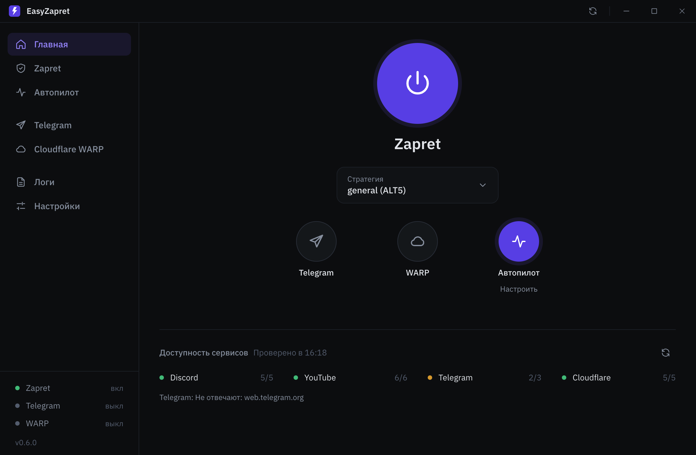
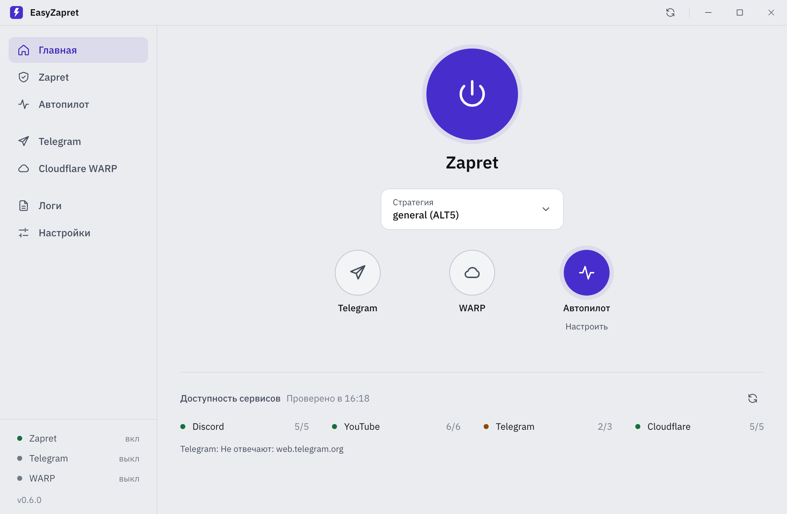
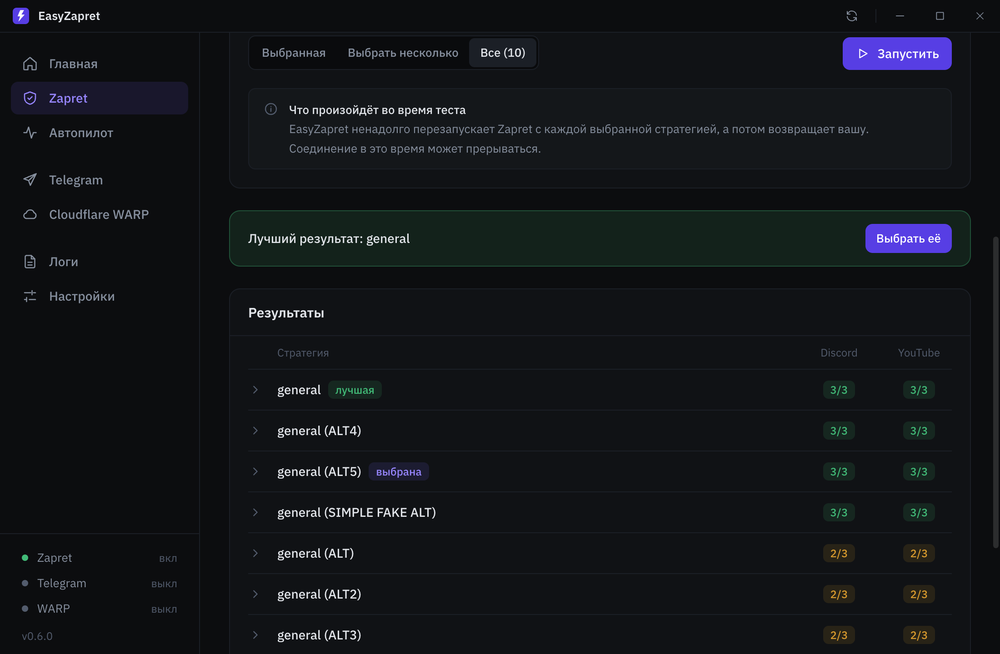
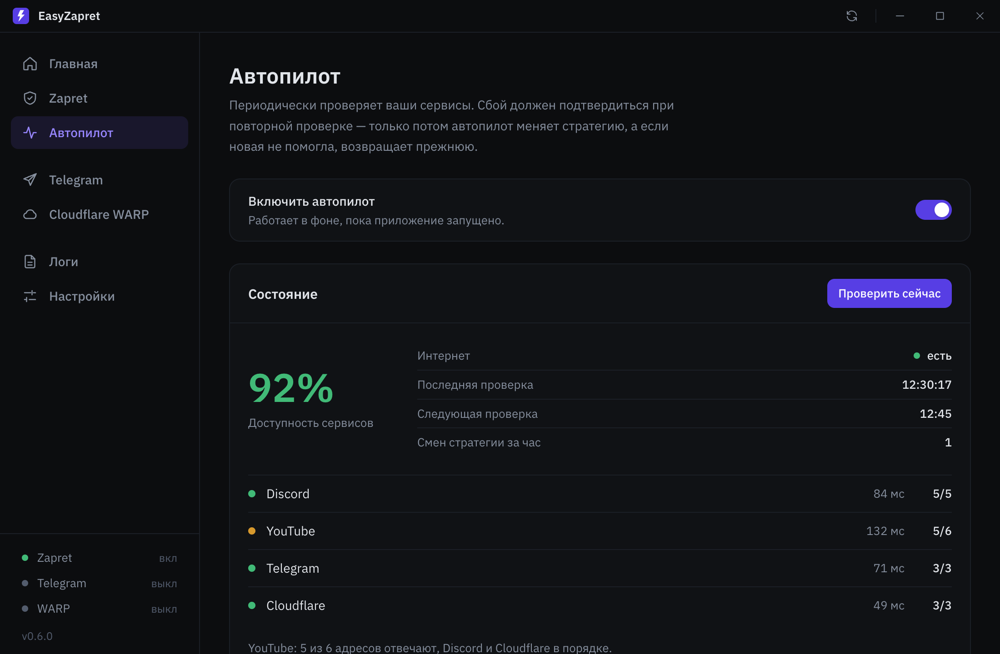
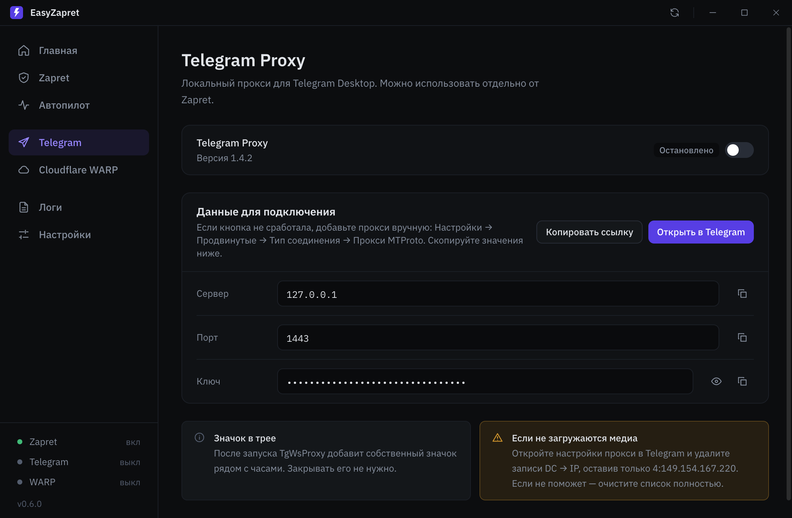
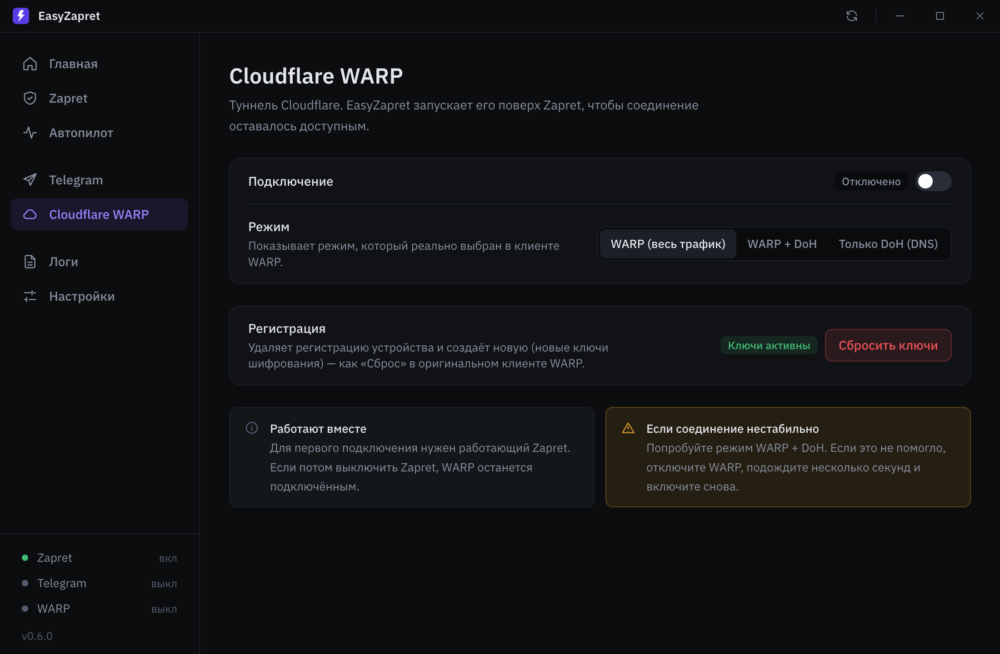

<p align="center">
  
</p>

<h1 align="center">EasyZapret</h1>

<p align="center">
  Zapret, Telegram Proxy и Cloudflare WARP в одном окне<br>
</p>

<p align="center">
  <a href="https://github.com/laciodanya/easyzapret/releases/latest">
    
  </a>
</p>

<p align="center">
  <a href="https://github.com/laciodanya/easyzapret/releases/latest"></a>
  <a href="https://github.com/laciodanya/easyzapret/releases"></a>
  <a href="LICENSE"></a>
</p>

<p align="center">
  
  
</p>

## Что это

EasyZapret ставит и запускает [zapret](https://github.com/bol-van/zapret) (сборку Flowseal для Discord и YouTube), прокси для Telegram и Cloudflare WARP. Включили кнопкой, выбрали стратегию, дальше оно работает само.

Сам zapret в репозитории не лежит. При первом запуске приложение скачивает всё нужное в `C:\EasyZapret`.

## Установка

1. Откройте [последний релиз](https://github.com/laciodanya/easyzapret/releases/latest) и скачайте `EasyZapret_*_x64-setup.exe`.
2. Запустите установщик. Windows может ругнуться про неизвестного издателя, у меня пока нет платного сертификата. Нажмите **Подробнее → Выполнить в любом случае**.
3. При первом запуске приложение предложит скачать Zapret и Telegram Proxy. Соглашайтесь.

Нужна Windows 10 или 11 (x64) и интернет при первом запуске. Приложение само просит права администратора, без них zapret не заработает.

## Что есть внутри

**Главная.** Большая кнопка включает Zapret, под ней выбор стратегии. Рядом такие же кнопки для Telegram Proxy, WARP и Автопилота. Ниже коротко видно, открываются ли Discord, YouTube, Telegram и Cloudflare прямо сейчас.

**Тесты стратегий.** Стратегий в zapret много, и какая из них сработает у вас, заранее не угадать. Тесты прогоняют их по очереди и показывают таблицу стратегия × сервис. Можно проверить только Discord, только YouTube, выбрать несколько стратегий руками или прогнать все.

<p align="center">
  
</p>

**Автопилот.** По расписанию проверяет сервисы. Если что-то отвалилось, не бросается менять стратегию сразу, а сначала перепроверяет. Если интернета нет совсем, ничего не трогает. Если новая стратегия оказалась хуже, возвращает прежнюю. Все решения пишутся в журнал на той же странице.

<p align="center">
  
</p>

**Telegram Proxy.** Запускает локальный прокси для Telegram Desktop. Сервер, порт и ключ можно скопировать по отдельности, ключ можно показать, есть ссылка для быстрого подключения.

**Cloudflare WARP.** Включает и выключает WARP, переключает режимы и сбрасывает ключи. Запускает его после Zapret, чтобы они не мешали друг другу. Нужен официальный клиент [Cloudflare WARP](https://one.one.one.one/), других приложений для WARP EasyZapret не поддерживает.

<p align="center">
  
  
</p>

Кроме этого:

- установка Zapret как службы Windows и свои списки доменов и IP;
- автозапуск с Windows и работа из трея;
- обновление приложения и компонентов прямо из окна, кнопка проверки в правом верхнем углу;
- логи по каждой части и отчёт для GitHub одной кнопкой;
- светлая, тёмная и системная тема, русский и английский.

## Если что-то не работает

**Zapret не запускается или пропал `WinDivert64.sys`.** Скорее всего, антивирус удалил `winws.exe` или драйвер WinDivert. Добавьте `C:\EasyZapret` в исключения и переустановите компонент в настройках.

**Часть сайтов грузится нестабильно.** Включите DNS-over-HTTPS в Windows или браузере, обычно хватает `1.1.1.1` или `8.8.8.8`.

**Не грузятся фото и видео в Telegram через прокси.** В настройках прокси в Telegram удалите записи DC → IP и оставьте только `4:149.154.167.220`. Не помогло, очистите список полностью.

**WARP работает нестабильно.** Попробуйте режим WARP + DoH и сбросьте ключи на странице WARP. Проверьте, не стоят ли рядом ExitLag, GearUP или другой обход, они конфликтуют. Если и это не помогло, сбросьте сетевые настройки Windows и перезагрузитесь.

**Нашли баг.** Откройте **Логи → Отчёт для GitHub**, скопируйте отчёт и приложите к [новому issue](https://github.com/laciodanya/easyzapret/issues/new). С отчётом разобраться в разы быстрее.

## Где лежат данные

Всё в `C:\EasyZapret`, поэтому переустановка приложения настройки не трогает:

```text
C:\EasyZapret\
├── zapret\
├── tg-ws-proxy\
├── logs\
├── tmp\
└── config.json
```

## Сборка из исходников

Нужны Node.js, Rust и WebView2. Установщик собирается на Windows.

```bash
npm install
npm run tauri dev
npm run tauri build
```

Интерфейс на React и TypeScript, бэкенд на Rust и Tauri 2, установщик через NSIS.

## Благодарности

- [bol-van](https://github.com/bol-van) за оригинальный [zapret](https://github.com/bol-van/zapret) и winws;
- Flowseal за сборку zapret-discord-youtube и tg-ws-proxy;
- [hyperion-cs/dpi-checkers](https://github.com/hyperion-cs/dpi-checkers) за набор DPI-чекеров.

EasyZapret это независимый пользовательский проект. Пользуйтесь на свой риск и соблюдайте законы своей страны.
